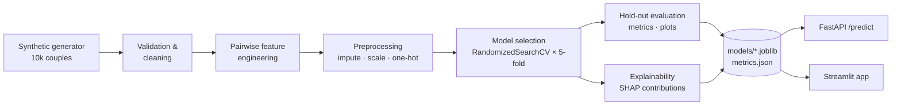

# An End-to-End Machine Learning Pipeline for Relationship Compatibility & Longevity Prediction

**Mini Project 2 — AI/ML**

A complete, reproducible ML system that takes the profiles of two partners and predicts:

| Output | Type | Model target |
|---|---|---|
| **Compatibility score** (0–100) | Binary classification | `compatible` |
| **Expected relationship duration** (years) | Regression (on log scale) | `longevity_years` |
| **Probability of lasting 5+ years** | Binary classification | `lasts_5_years` |

Each prediction comes with a **per-couple explanation** (the top factors pushing the score up or down), and the models are served through a **FastAPI REST API** and an interactive **Streamlit web app**.

> ⚠️ All data is **synthetic**. The project demonstrates ML engineering practice and is not a tool for making real relationship decisions.

---

## Pipeline architecture



1. **Data generation** (`src/relcompat/data/generate.py`): 10,000 couples with 20 attributes per partner: demographics, religion, wanting children, Big Five personality, love language, attachment style, hobbies, communication, conflict style, politics and lifestyle. There are also four couple-level fields: distance, how they met, months dating and cohabiting. Labels come from a documented latent "relationship quality" function plus noise, based on findings from relationship research. ~3% missing values and distance outliers are injected on purpose. Gender is generated but deliberately does not affect the labels.
2. **Validation** (`data/validate.py`): schema and range checks, duplicate and invalid-row removal.
3. **Feature engineering** (`features/build_features.py`): 33 **symmetric** pairwise features. Examples are age gap, personality distance, hobby Jaccard overlap, agreement on children, political distance, attachment-style pair and conflict-style pair. Swapping the two partners gives identical features, and a test enforces this. The same function is used for training and for serving, so the two can't drift apart.
4. **Preprocessing**: median imputation + standard scaling (numeric), constant imputation + one-hot encoding (categorical), fitted inside each model pipeline to avoid leakage.
5. **Model selection** (`models/train.py`): for each task, Logistic/Ridge regression, Random Forest and XGBoost are tuned with `RandomizedSearchCV` and 5-fold (stratified) cross-validation. The best model is chosen by **CV score**, not test score. Regressors are fitted on `log1p(years)` through `TransformedTargetRegressor`.
6. **Evaluation** (`models/evaluate.py`): accuracy, precision, recall, F1 and ROC-AUC, plus a confusion matrix and ROC curve for the classifiers. MAE, RMSE and R², plus predicted-vs-actual and residual plots, for the regressor.
7. **Explainability** (`models/explain.py`): exact per-feature contributions (XGBoost `pred_contribs`, SHAP `TreeExplainer` for forests, `coef × (x − mean)` for linear models), summed back from one-hot columns to readable feature names.
8. **Serving**: `Predictor` class → FastAPI and Streamlit.

## Results (hold-out test set, 2,000 couples)

| Task | Selected model | Key metrics |
|---|---|---|
| Compatibility | Logistic Regression | **ROC-AUC 0.881**, accuracy 0.787, F1 0.781 |
| Longevity (years) | Ridge (log target) | **R² 0.719**, MAE 1.84 yrs, RMSE 2.86 yrs |
| Lasts 5+ years | Logistic Regression | **ROC-AUC 0.926**, accuracy 0.838, F1 0.851 |

The full comparison of all candidates is in [`reports/model_comparison.md`](reports/model_comparison.md). XGBoost was a close second (ROC-AUC 0.874 for compatibility). The regularised linear models win because the hidden generating function is mostly additive on the log-odds scale. That is a useful lesson: the simplest well-tuned model can beat ensembles when the signal suits it.

**Sanity check:** the global SHAP importance plot recovers the rules hidden in the generator. Agreement on children, attachment-style pairing, the agreeableness gap and religious alignment rank highest, which is evidence that the pipeline learns real structure rather than noise. An oracle that knows the noise-free latent score reaches about 0.89 ROC-AUC, so 0.88 is close to the best achievable.

Figures are written to `reports/figures/`: diagnostics, global importance and SHAP beeswarm for every task.

## Project structure

```
config/config.yaml          # seed, dataset size, CV folds, search iterations, paths
src/relcompat/
  schemas.py                # vocabularies + pydantic request/response models
  config.py                 # YAML -> Config dataclass
  pipeline.py               # orchestrates all stages
  data/generate.py          # synthetic data generator
  data/validate.py          # schema checks & cleaning
  features/build_features.py
  models/train.py · evaluate.py · explain.py · predict.py
api/main.py                 # FastAPI service
app/streamlit_app.py        # Streamlit UI
notebooks/01_eda.ipynb      # exploratory data analysis
tests/                      # 27 pytest tests
run_pipeline.py             # CLI entry point
Dockerfile · docker-compose.yml · Makefile
```

## Getting started

```bash
pip install -r requirements.txt
pip install -e .

python run_pipeline.py            # full run (~2 min): data, models, metrics, figures
python run_pipeline.py --quick    # fast smoke run
python -m pytest -q               # run the test suite
```

### REST API

```bash
uvicorn api.main:app --reload
# interactive docs: http://localhost:8000/docs
```

| Endpoint | Description |
|---|---|
| `GET /health` | Service status and whether models are loaded |
| `GET /model-info` | Selected models and their test metrics |
| `POST /predict` | Score a couple (`CoupleInput` JSON → `PredictionOut`) |

Response for the built-in example couple (`EXAMPLE_COUPLE` in `schemas.py`, also pre-filled in `/docs`), truncated:

```json
{
  "compatibility_score": 94.7,
  "compatible": true,
  "compatibility_label": "High",
  "expected_years": 13.9,
  "lasts_5_years_probability": 0.996,
  "top_factors": [
    {"feature": "hobby_jaccard", "description": "Overlap in hobbies", "value": 0.5, "impact": 0.9116, "effect": "increases"},
    {"feature": "children_match", "description": "Agreement on wanting children", "value": 0.5, "impact": -0.7774, "effect": "decreases"}
  ]
}
```

### Web app

```bash
streamlit run app/streamlit_app.py     # http://localhost:8501
```

Fill in both partners' profiles to see the compatibility gauge, the longevity estimate and "what drives this prediction" charts. A second tab shows the model comparison tables and evaluation figures.

### Docker

```bash
docker compose up --build    # API on :8000, app on :8501 (models are trained during the image build)
```

## Configuration

Edit `config/config.yaml` or override from the CLI:

```bash
python run_pipeline.py --n-samples 20000 --n-iter 15 --cv-folds 5 --seed 7
```

## Ethics & limitations

- The data is synthetic, and its label rules are simplified assumptions, not established science. Real relationships depend on far more than any questionnaire captures.
- Protected attributes (gender) are excluded from the features and play no part in the labels. Religion appears only as *same vs different*, never as a specific religion.
- Predictions describe statistical patterns in a simulated population. They should never be used to judge or advise real couples.
